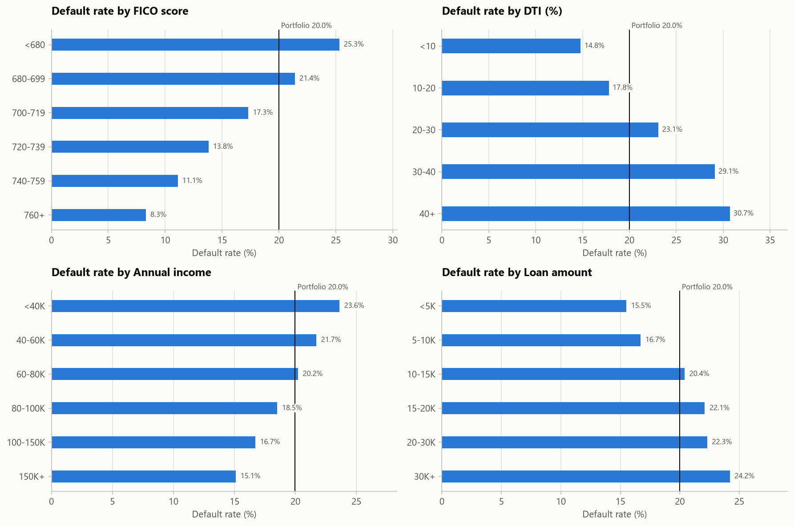
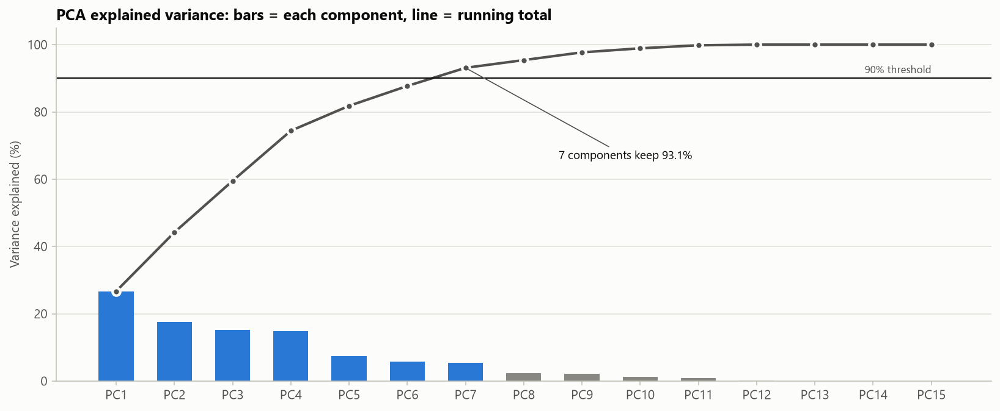
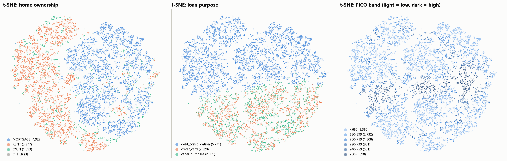

# Credit Portfolio Segmentation and Risk Pattern Analysis

Unsupervised segmentation of **1.35 million Lending Club loans**. The project groups
borrowers with similar financial and credit characteristics (K-Means, Hierarchical
Clustering and DBSCAN), profiles each segment, compares the segments' historical
default rates, flags unusual borrowers and presents the results in an interactive
Streamlit dashboard.

> **Status (15 Nov 2026):** Stages 0–5 are complete: data understanding,
> preprocessing, exploratory data analysis, feature engineering and dimensionality
> reduction (PCA, t-SNE, UMAP). **Next:** clustering and evaluation (notebook 04).

## Key rule: `Default` is never a clustering feature

Clustering uses only what is known about the borrower and the loan at application
time. The `Default` column (1 = charged off, 0 = fully paid) is kept out of every
feature matrix (the code stops with an error if it ever appears there), so it never
influences how the segments are formed. It is used in the EDA and, **after
clustering**, to compare historical default rates across segments.

## Progress

| Stage | Work | Main outputs | Status |
|---|---|---|---|
| 0 | Project setup | `requirements.txt`, `check_environment.py`, Git repository | ✅ |
| 1 | Data understanding | Notebook 01, `reports/data_dictionary.csv` | ✅ |
| 2 | Preprocessing | Notebook 01, `reports/cleaning_log.csv` | ✅ |
| 3 | Exploratory data analysis | Notebook 02, `reports/eda_default_rates.csv`, 7 charts | ✅ |
| 4 | Feature engineering and scaling | Notebook 03, `src/features.py`, `models/feature_pipeline.pkl` | ✅ |
| 5 | Dimensionality reduction (PCA, t-SNE, UMAP) | Notebook 03, `src/dimensionality.py`, 5 charts | ✅ |
| 6–7 | Clustering (K-Means, Hierarchical, DBSCAN) and evaluation | Notebook 04 | ⏳ next |
| 8 | Default pattern analysis by segment | — | ⏳ |
| 9 | Anomaly detection | — | ⏳ |
| 10 | Streamlit dashboard | `app.py` | ⏳ |
| 11 | Documentation, report and presentation | — | ⏳ |

## Dataset

*Lending Club loan dataset for granting models* (Ariza-Garzón, Sanz-Guerrero,
Arroyo and Lending Club, 2024, [Zenodo record 11295916](https://zenodo.org/records/11295916)),
provided by the course.

- **1,347,681 loans × 15 columns**, issued from June 2007 to December 2018.
- Only loans with a final status are included: **19.98% defaulted** (269,249 loans).
- The CSV (167 MB) is **not stored in this repository** because it is larger than
  GitHub's 100 MiB file limit. Save it as `data/raw/loans_granting_model_dataset.csv`.

How each column is used (full details in `reports/data_dictionary.csv`):

| Role | Columns |
|---|---|
| Clustering features | `revenue` (annual income), `dti_n`, `loan_amnt`, `fico_n`, `emp_length`, `purpose`, `home_ownership_n` |
| Profiling and trend analysis only | `addr_state`, `issue_d` |
| Outcome: EDA and post-clustering analysis only | `Default` |
| Not used | `id` (identifier), `experience_c` (almost constant), `zip_code` (sensitive location), `title` and `desc` (borrower free text) |

## Setup

The project was developed with Python 3.14; library versions are pinned in
`requirements.txt`.

```bash
# 1. Create and activate a virtual environment
python -m venv .venv
.venv\Scripts\activate          # Windows
# source .venv/bin/activate     # macOS / Linux

# 2. Install the dependencies
pip install -r requirements.txt

# 3. Check the Python version, the libraries and the dataset
python check_environment.py
```

## How to run

Open the notebooks in VS Code or Jupyter, select the `.venv` kernel and run them
**in order** (Run All). Each notebook saves files that the next one reads. Every
notebook explains each step, shows how to read its output and ends with viva
questions and answers.

| Notebook | What it does | Saves |
|---|---|---|
| `01_data_understanding_and_preprocessing` | Profiles the 15 columns, finds hidden missing values and cleans the data | `data/processed/loans_clean.pkl`, `reports/data_dictionary.csv`, `reports/cleaning_log.csv`, `reports/figures/01_*.png` |
| `02_exploratory_data_analysis` | Distributions, correlations and default rates by value band, purpose, home ownership, state and year | `reports/eda_default_rates.csv`, `reports/figures/02_*.png` |
| `03_features_and_dimensionality_reduction` | Builds and scales the features, runs PCA and draws t-SNE and UMAP maps | `models/feature_pipeline.pkl`, `data/processed/features_pca.npy`, `data/processed/map_sample.pkl`, `reports/figures/03_*.png` |

In notebook 03, t-SNE takes about 1.5 minutes and UMAP about 2.5 minutes on a laptop.

## Methodology so far

**Preprocessing (notebook 01)**

- Dropped the borrower free-text columns `title` and `desc` (`desc` is 91% missing).
  There are no duplicate rows or loan ids.
- `issue_d` → issue date, year and month.
- `emp_length` → years (0–10). "NI" (no information; 78,188 loans, 5.8%) becomes a
  missing value plus a 0/1 "unknown" flag.
- `dti_n` = 999 (38 loans) is a placeholder code, so it becomes a missing value.
- Every step and the number of rows it changed are logged in `reports/cleaning_log.csv`.

**Feature engineering (notebook 03): 8 features → 15 model columns**

- Income is log-transformed with `log1p`, because it is extremely skewed
  (skewness 45.4, maximum \$11.0 million).
- DTI is capped at its 99th percentile (38.48), which limits the long tail but keeps
  every loan.
- Missing values are filled with the median, and the 5 numeric features are
  standardised (mean 0, standard deviation 1).
- Home ownership (4 categories) and loan purpose (14 categories grouped into 5) are
  one-hot encoded and kept as 0/1, **not** standardised. A standardised 1 for the
  rare OTHER home status (0.04% of loans) would become 51 and dominate the distances.
- All steps run in one scikit-learn `Pipeline`, saved to `models/feature_pipeline.pkl`
  for reuse in clustering and in the dashboard.

**Dimensionality reduction (notebook 03)**

- **PCA:** 7 of the 15 components keep **93.1%** of the variance (the first count
  above 90%). These 7 components are the planned input for clustering.
- **t-SNE** (perplexity 30) and **UMAP** (15 neighbours, `min_dist` 0.1) run on the
  7 PCA components of a fixed 10,000-loan sample. They are for visualisation only.

## Key findings so far

**Historical default rates** (portfolio average **19.98%**). Spread = highest minus
lowest group rate, in percentage points.

| Feature | Lowest default rate | Highest default rate | Spread |
|---|---|---|---|
| Loan purpose | wedding 12.4% | small business 29.9% | 17.5 |
| FICO score | 760 and above 8.3% | below 680 25.3% | 17.0 |
| Debt-to-income (%) | below 10: 14.8% | 40 and above: 30.7% | 15.9 |
| State (50 with at least 1,000 loans) | DC 13.2% | MS 26.1% | 12.9 |
| Issue year | 2009: 13.7% | 2007: 26.4% | 12.7 |
| Loan amount | below 5K: 15.5% | 30K and above: 24.2% | 8.7 |
| Annual income | 150K and above: 15.1% | below 40K: 23.6% | 8.5 |
| Employment length | 10+ years 18.8% | not stated 27.0% | 8.2 |
| Home ownership | mortgage 17.2% | rent 23.2% | 6.0 |



- The default rate falls steadily as FICO score and income rise, and climbs steadily
  with DTI and loan amount.
- Borrowers who did not state their employment length defaulted far more often
  (27.0%) than every other employment group (18.8–20.6%).
- The numeric features are only weakly related to each other (Spearman |ρ| ≤ 0.19),
  except income and loan amount (0.49).
- **Caution:** 2007 has only 599 loans, and 2017–2018 contain only loans that had
  already finished, so those years are biased samples.

**PCA:** PC1 measures financial capacity (income and loan amount move together) and
PC2 measures debt burden (mostly DTI).



**t-SNE and UMAP:** both maps separate borrowers mainly by **home ownership** (renters
vs mortgage holders) and then by **loan purpose** (debt consolidation vs credit card
and other purposes). FICO score does not form its own groups; it varies inside these
regions. The UMAP and PCA maps are in `reports/figures/03_umap_map.png` and
`reports/figures/03_pca_map.png`.



## Responsible use

- Segments describe **groups of past loans**, not individuals. Belonging to a
  high-default segment says nothing certain about a single borrower and is not a
  credit decision.
- `Default` never influences how the segments are formed (see the key rule above).
- Borrower free text (`title`, `desc`) is dropped and never displayed; zip codes are
  not used.
- The data covers Lending Club loans from 2007 to 2018 with a final status, so the
  patterns may not hold for other lenders or later years.

## Reproducibility

- One random seed (`RANDOM_SEED = 42` in `src/config.py`) for every random step:
  sampling, PCA, t-SNE and UMAP.
- Library versions are pinned in `requirements.txt`.
- File paths and column names live in `src/config.py`; reusable code lives in `src/`.
- `models/feature_pipeline.pkl` contains a custom transformer
  (`src.features.UpperCapper`), so load it with the project root on the Python path,
  as the notebooks do.

## Project structure

```
credit-portfolio-segmentation/
├── data/
│   ├── raw/                     # original CSV (not committed)
│   └── processed/               # files created by the notebooks (not committed)
├── models/
│   └── feature_pipeline.pkl     # preprocessing + PCA (7 components)
├── notebooks/
│   ├── 01_data_understanding_and_preprocessing.ipynb
│   ├── 02_exploratory_data_analysis.ipynb
│   └── 03_features_and_dimensionality_reduction.ipynb
├── reports/
│   ├── figures/                 # charts for the reports and the presentation
│   ├── cleaning_log.csv
│   ├── data_dictionary.csv
│   └── eda_default_rates.csv
├── src/
│   ├── config.py                # paths, column names and the random seed
│   ├── data_processing.py       # loading and cleaning
│   ├── eda.py                   # value bands, default-rate tables and EDA charts
│   ├── features.py              # feature table and the preprocessing + PCA pipeline
│   ├── dimensionality.py        # sampling and the t-SNE / UMAP map charts
│   └── plot_style.py            # shared chart style
├── check_environment.py
├── requirements.txt
└── README.md
```

## Tools

Python 3.14 · pandas · NumPy · scikit-learn · SciPy · umap-learn · Matplotlib ·
seaborn · Streamlit (dashboard, Stage 10)
